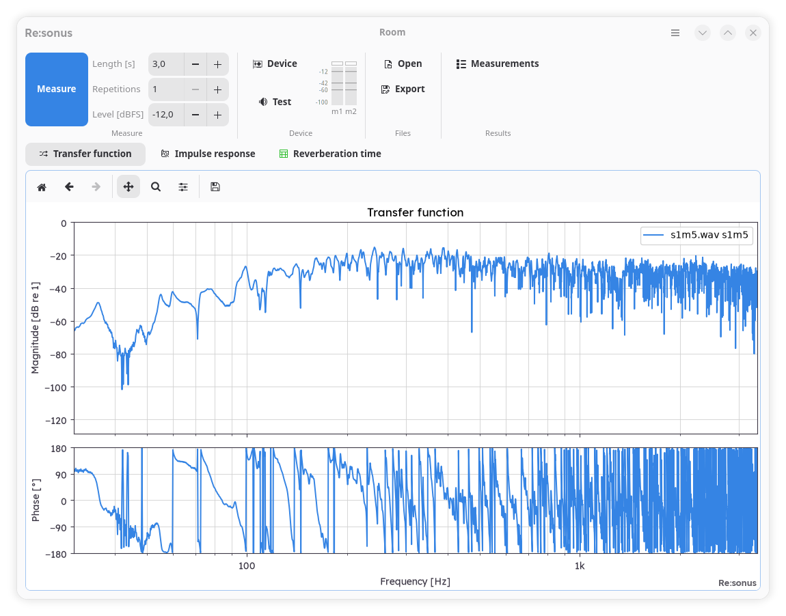

# Re:sonus Room

Room-acoustic measurement and analysis: impulse responses by sweep, noise or MLS,
reverberation times and room acoustic parameters per **ISO 3382-1/-2**, and the sound
absorption coefficient of a test specimen per **ISO 354** (reverberation room method).
Desktop app (GTK 4 / libadwaita), command line and Python/Jupyter, all on one core.

> Status: pre-release (0.1.1). Calculation methods follow the cited standards and are
> tested, but this is not a type-approved instrument; band-filter conformance to
> IEC 61260-1 is not verified yet. See [Validation](#validation).

## Features
- **Measurement:** exponential sweep (also synchronized), noise, MLS; repetitions with
  synchronous averaging; optional loopback reference; several inputs and outputs
  (simultaneous or one output after the other); level test with live input meters.
- **Transfer function** (magnitude and phase), **impulse response** with the decay
  curve and fit lines of each band, **reverberation time** per octave or one-third
  octave.
- **ISO 3382:** EDT, T20, T30 with fit quality (r², ξ, curvature C, peak-to-noise
  ratio, flags; ISO 3382-2:2008 Annex B), C50, C80, D50, Ts, IACC (ISO 3382-1 Annex B);
  room average over positions (ISO 3382-2 clause 8) with the Table 1 position check.
- **ISO 354:** equivalent absorption area and αs with uncertainty from the measured
  decays, air absorption per ISO 9613-1.
- **REW import and comparison:** RT60 exports read and compared band by band.
- Results as HDF5 (documented in [docs/FILE_FORMAT.md](docs/FILE_FORMAT.md)), CSV, JSON
  and PNG/PDF/SVG plots.

## Installation
Python ≥ 3.12 and, for the GUI and audio, GTK 4, libadwaita and PortAudio. PyGObject is
built from source by pip, so it needs the GObject introspection headers. On Fedora:

    sudo dnf install gtk4 libadwaita portaudio gobject-introspection-devel \
        cairo-gobject-devel python3-devel gcc pkgconf

Then, in a virtual environment:

    python -m venv .venv
    .venv/bin/pip install "resonus-room @ git+https://github.com/resonus-cz/resonus-room@v0.1.1"

Exact versions of all dependencies, as tested: `pip install -r requirements.lock`.

## Usage
- **GUI:** `resonus-room-gui`. Ribbon: Measure (length, repetitions, level), Device
  (preferences, level test, input meters), Files (open, export), Results (measurements
  shown and overlaid); tabs Transfer function, Impulse response, Reverberation time.
- **Command line:** `resonus-room --help`. Examples:

      resonus-room test-levels --simulate                 # level test, simulated room
      resonus-room measure --simulate --out run1          # measure and analyse
      resonus-room analyze run1/impulse_response.h5 --json
      resonus-room absorption setup.toml --out alpha      # ISO 354 evaluation
      resonus-room settings my.toml                       # default settings to edit

  `--settings my.toml` applies a settings file (device, channels, analysis options).
- **Python / Jupyter:** [examples/resonus_room.ipynb](examples/resonus_room.ipynb)
  (level test, measurement, analysis, plots, ISO 354) runs on the simulated room.

The simulated room (`--simulate`, or "Simulated device" in the preferences) needs no
sound card.

## Validation
- [docs/COMPLIANCE.md](docs/COMPLIANCE.md): each requirement of the standards (edition,
  clause) with the code that implements it and the test that checks it.
- [docs/VERIFICATION.md](docs/VERIFICATION.md): checks against independent references
  (closed-form results, standard tables, REW) and their status. The REW cross-checks
  use the maintainer's own measurements, which are not published; those tests are
  skipped without them.
- [docs/DECISIONS.md](docs/DECISIONS.md) and [docs/QUESTIONS.md](docs/QUESTIONS.md):
  method decisions, the provisional ones and the open questions.

Standards are copyrighted and not distributed; the code and tests cite edition and
clause and quote only the numeric values the tests need.

## Development

    .venv/bin/pip install -e ".[dev]"
    scripts/check.sh        # pytest, ruff (lint + format), mypy

## Related
[resonus-core](https://github.com/resonus-cz/resonus-core): the shared library (audio
I/O, bands, air absorption, data model and file format, plot style, GTK host).

## License
[AGPL-3.0-only](LICENSE). Copyright © 2026 David Jun (Re:sonus, resonus.cz). Contributions: see
[CONTRIBUTING.md](CONTRIBUTING.md). Third-party notices: [THIRD_PARTY.md](THIRD_PARTY.md).
